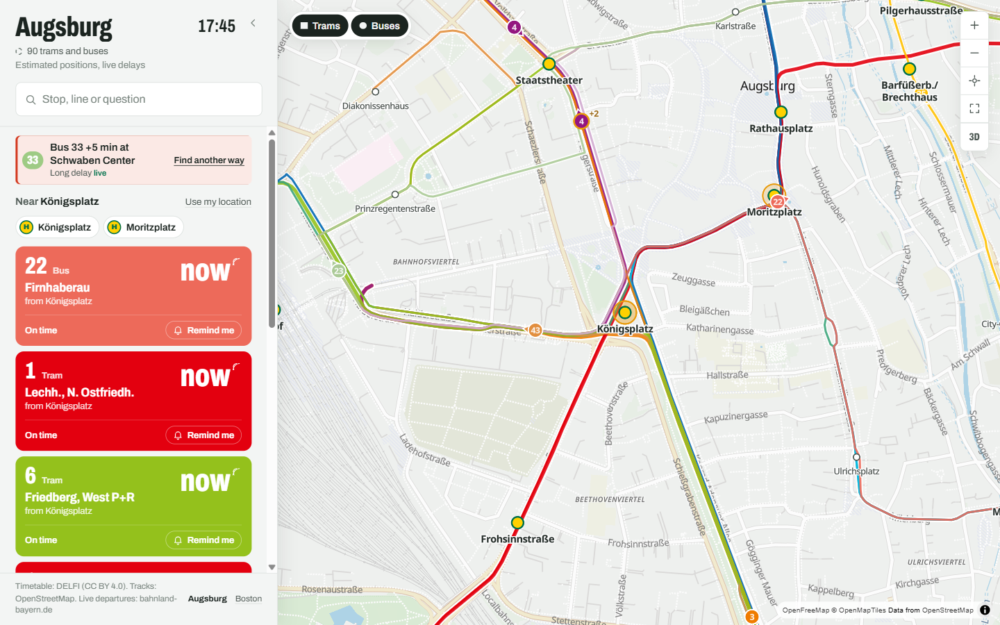
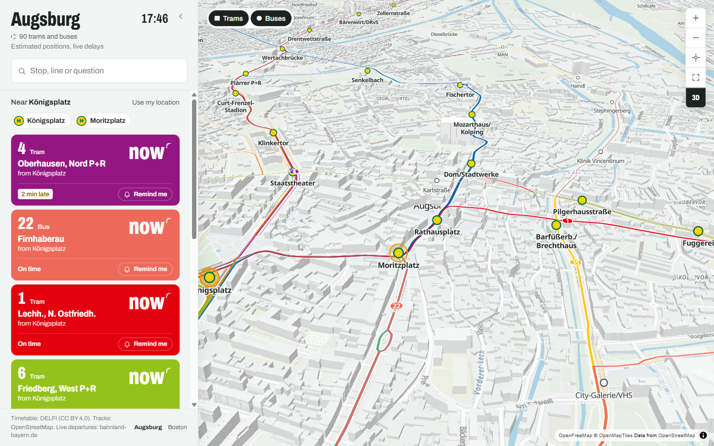

# Augsburg in Motion

Augsburg's trams and buses on a live street map. It opens on the stops near you with
the next departures in big type, shows which lines are late, reminds you when to leave,
and finds another way when a line breaks down. Every time says whether it is live or a
scheduled estimate.



City view (optional 3D, for showing off):



## Run it

```bash
python -m venv .venv && source .venv/bin/activate
pip install -r requirements.txt
cp .env.example .env          # optional: add OPENAI_API_KEY
python main.py                # http://127.0.0.1:8000
```

API docs (Swagger) are at `/docs`. Tests: `pytest`.

## Do I need Python?

The map, the 3D trains and the UI are plain HTML, CSS and JavaScript with no build
step. Python (FastAPI) is used for the parts a browser can't do well on its own:

- **Keeping secrets off the page.** The OpenAI key and any transit API keys stay on the server.
- **Calling transit APIs.** Most of them block direct browser calls (CORS) or rate-limit per client.
  The server fetches once and streams to every viewer over a WebSocket.
- **Route planning.** A time-dependent Dijkstra over the network, using where every vehicle is right now.
- **Reading GTFS.** Timetable feeds are zip files of large CSVs.

## What's real and what's estimated

| | Augsburg | Boston (second city) |
|---|---|---|
| Network (lines, stops, track) | **Official timetable** (DELFI GTFS) with track geometry and line colours from OpenStreetMap, once you build it (below). Without it, a small bundled approximation | Live from the MBTA API |
| Vehicle positions | **Estimated from the timetable**: swa doesn't publish vehicle locations. Each line runs at its **live delay**, sampled from real departure boards | **Live** GPS from the MBTA API |
| Departure boards and delays | **Live** from the Bavarian EFA planner (bahnland-bayern.de) when reachable, otherwise estimated and labelled so | Estimated from live positions |

### Use the official Augsburg network

The free nationwide DELFI feed (CC BY 4.0) has every swa tram and bus (trams 1-6, buses
21-48, 70-78 and the night buses 90-94) but no track shapes, so the build script adds
geometry and colours from OpenStreetMap route relations:

```bash
curl -L -o nv_free.zip https://download.gtfs.de/germany/nv_free/latest.zip   # ~280 MB
python scripts/build_augsburg_gtfs.py nv_free.zip     # -> app/data/gtfs/augsburg.zip (~1 MB)
```

Run it again when the timetable changes (DELFI updates weekly). Vehicles only appear
on days and hours when the timetable runs their line, so night and school buses come
and go as they do on the street.

### Punctuality log

Set `DELAY_LOG_ENABLED=true` to keep sampling live departure boards in the background
(a few hub stops plus a rotating handful of others every two minutes) and store each
departure's final observed delay in `app/data/delays.sqlite`. After a few weeks,
`GET /api/v1/augsburg/punctuality?days=30` gives each line's punctual share (under
3 min late), on-time share (under 1 min), average and worst delay.

## Features

- **Near me first**: the closest stops (your location, or Königsplatz) as one card per
  line and direction, in the line's colour, with the next three times. Live times carry
  a signal mark; scheduled estimates a `~`.
- **Leave-now reminder**: tap *Remind me* and you get a notification when it's time to walk
  to the stop, moved automatically if the tram runs late. It needs the tab to stay open.
- **Delays first**: long delays sit at the top with *Find another way*, which plans the same
  trip around that line. Shorter delays are one compact line; delayed stops are ringed on the map.
- **One search box**: a stop ("Uni") opens its departure board, a line ("41") highlights it,
  and a sentence goes to the assistant ("next tram to Göggingen").
- **The map does the work**: tap a stop for its live board; tap a vehicle for its line,
  destination, delay and the rest of its route, drawn on the map.
- **Filters**: trams and buses on or off; in *All lines*, tap lines to show only those.
- **Route planner**: fastest, fewest changes or least walking; the first wait comes from the
  next real departure.
- **City view**: an optional 3D view of the old town with OpenStreetMap buildings, for
  showing off. Not the default.
- **Dark mode** follows the system setting.
- **Keyboard**: `/` search, `R` whole network, `F` follow the selected vehicle, `Esc` clear.

## Project layout

```
main.py                    entry point (python main.py / uvicorn main:app)
app/
  factory.py               FastAPI app factory, lifespan, static files
  core/                    settings (.env), logging
  api/
    router.py              /api/v1 + /ws
    deps.py                provider lookup, shared dependencies
    v1/                    system, network, vehicles, planner, assistant, realtime (WebSocket)
  schemas/                 Pydantic models: transit, planner, assistant
  services/
    hub.py                 provider registry + demand-driven polling + WebSocket fan-out
    routing.py             live-aware journey planner
    assistant.py           OpenAI tool-calling loop + offline fallback
    delaylog.py            SQLite log of observed delays -> punctuality stats
    gtfs.py                GTFS feed -> network
    geo.py                 haversine, polylines, linear referencing, polyline decoding
    providers/
      base.py              provider contract + ETAs, boards, line status, search
      simulation.py        deterministic timetable simulation
      augsburg.py          Augsburg (GTFS or bundled, EFA live departures)
      mbta.py              Boston, live MBTA V3 API
  data/
    augsburg.py            bundled Augsburg network
    scenery.py             offline schematic basemap
    gtfs/                  put augsburg.zip here
  static/
    index.html, css/app.css
    js/core/               api, realtime, store, geo, format
    js/map/                mapView (MapLibre), vehicles (dots + delay tags), styles
    js/ui/                 home (near me, alerts, reminders), search, planner, lines,
                           assistant, inspector (stop display), autocomplete
scripts/build_augsburg_gtfs.py   DELFI timetable + OSM geometry -> app/data/gtfs/augsburg.zip
tests/                     pytest: geometry, simulation, routing, GTFS, EFA, OpenAI loop, API
docs/PUBLIC_APIS.md        open transit APIs you can plug in next
```

## Adding a city

Subclass `TransitProvider` (`app/services/providers/base.py`), implement `describe`,
`load_network` and `fetch_vehicles`, and register it in `app/services/hub.py`. ETAs,
boards, routing and the assistant then work automatically. If the city publishes GTFS,
`load_gtfs_network` plus `LineSimulation` gives you a working provider in about 30 lines.
