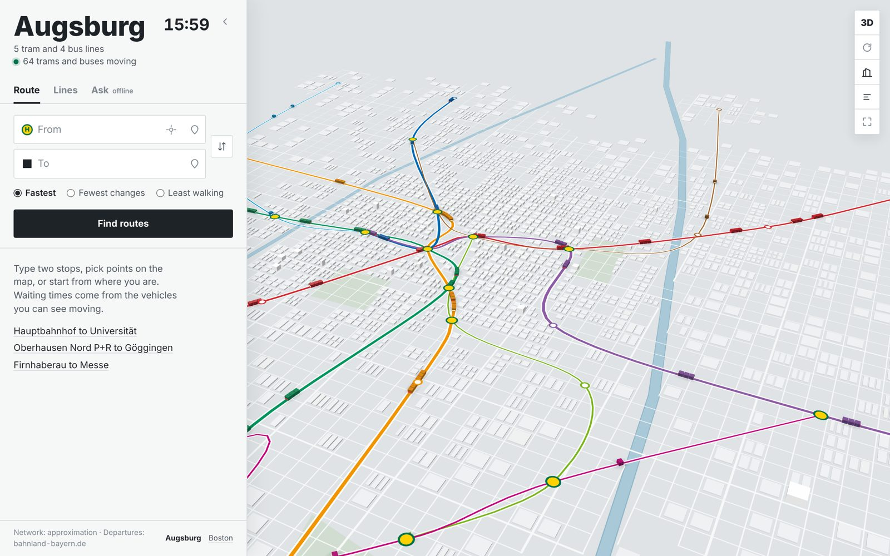
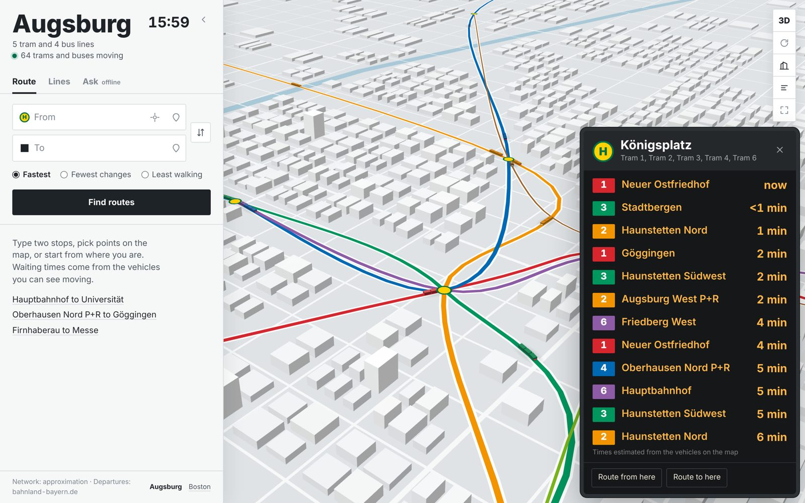
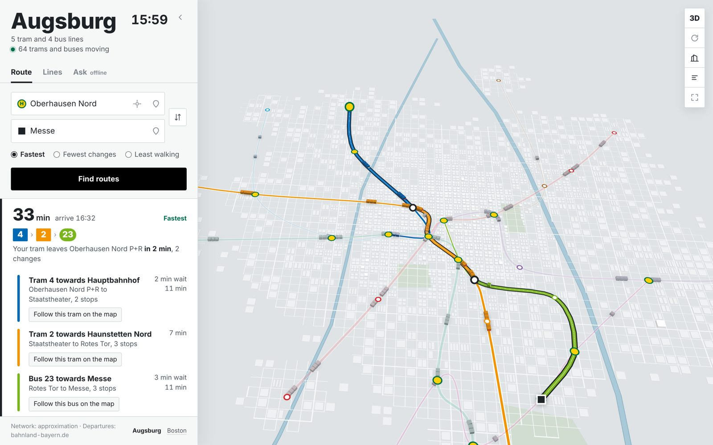
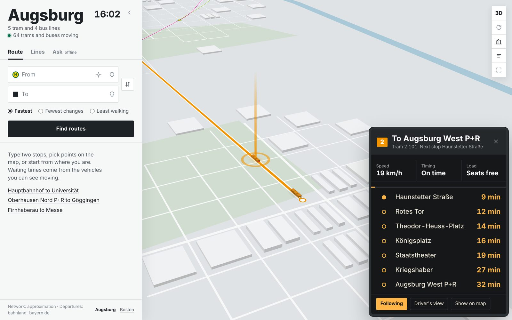

# Augsburg in Motion

A live 3D map of Augsburg's trams and buses. Every vehicle moves along its track,
you can click any tram, bus or stop, plan a trip with real waiting times, and ask an
AI assistant (OpenAI) how to get somewhere.



| Stop display | Route | Following a tram |
|---|---|---|
|  |  |  |

## Run it

```bash
python -m venv .venv && source .venv/bin/activate
pip install -r requirements.txt
cp .env.example .env          # optional: add OPENAI_API_KEY
python main.py                # http://127.0.0.1:8000
```

API docs (Swagger) are at `/docs`. Tests: `pytest`.

## Do I need Python?

The map, the 3D trains and the UI are plain HTML, CSS and JavaScript with no build
step. Python (FastAPI) is used for the parts a browser can't do well on its own:

- **Keeping secrets off the page.** The OpenAI key and any transit API keys stay on the server.
- **Calling transit APIs.** Most of them block direct browser calls (CORS) or rate-limit per client.
  The server fetches once and streams to every viewer over a WebSocket.
- **Route planning.** A time-dependent Dijkstra over the network, using where every vehicle is right now.
- **Reading GTFS.** Timetable feeds are zip files of large CSVs.

## What's real and what's simulated

| | Augsburg | Boston (second city) |
|---|---|---|
| Network (lines, stops, shapes) | Bundled approximation, or the **official GTFS feed** if you add it | Live from the MBTA API |
| Vehicle positions | **Simulated from the timetable**: swa doesn't publish open vehicle positions | **Live** GPS from the MBTA API |
| Departure boards | **Live** from the Bavarian EFA planner (bahnland-bayern.de) when reachable, otherwise estimated | Estimated from live positions |

Use the official Augsburg network: download the AVV GTFS feed (or the nationwide
DELFI feed from gtfs.de) and save it as `app/data/gtfs/augsburg.zip`. The loader keeps
trams and buses within 12 km of the centre.

## Features

- **3D map**: OpenStreetMap streets with extruded buildings, styled as a pale architectural model.
  Trams are articulated, so each car follows the track curve. Buses are single bodies. Vehicles glide
  between updates.
- **Click a tram or bus**: destination, next stops with times, speed, delay and load. Use *Follow* or
  *Driver's view*.
- **Click a stop**: a departure display styled after swa's LED boards, with *Route from here* / *to here*.
- **Route planner**: stop names (typo- and umlaut-tolerant), a point on the map, or your location.
  Choose fastest, fewest changes or least walking. The first wait comes from the real next vehicle.
- **AI assistant**: OpenAI function calling over the same planner, departures and line-status tools,
  so it never invents times. Without a key, a built-in parser handles the common questions.
- **Lines**: trams and buses with service state, frequency and vehicles running. Click one to focus it.
- **Realtime**: WebSocket stream with automatic reconnect and REST polling fallback.
- **Keyboard**: `/` search, `3` tilt, `O` orbit, `B` buildings, `L` labels, `R` whole city, `F` follow, `Esc` clear.

## Project layout

```
main.py                    entry point (python main.py / uvicorn main:app)
app/
  factory.py               FastAPI app factory, lifespan, static files
  core/                    settings (.env), logging
  api/
    router.py              /api/v1 + /ws
    deps.py                provider lookup, shared dependencies
    v1/                    system, network, vehicles, planner, assistant, realtime (WebSocket)
  schemas/                 Pydantic models: transit, planner, assistant
  services/
    hub.py                 provider registry + demand-driven polling + WebSocket fan-out
    routing.py             live-aware journey planner
    assistant.py           OpenAI tool-calling loop + offline fallback
    gtfs.py                GTFS feed -> network
    geo.py                 haversine, polylines, linear referencing, polyline decoding
    providers/
      base.py              provider contract + ETAs, boards, line status, search
      simulation.py        deterministic timetable simulation
      augsburg.py          Augsburg (GTFS or bundled, EFA live departures)
      mbta.py              Boston, live MBTA V3 API
  data/
    augsburg.py            bundled Augsburg network
    scenery.py             offline schematic basemap
    gtfs/                  put augsburg.zip here
  static/
    index.html, css/app.css
    js/core/               api, realtime, store, geo, format
    js/map/                mapView (MapLibre), trainLayer (Three.js), styles
    js/ui/                 planner, lines, assistant, inspector (stop display), autocomplete
tests/                     pytest: geometry, simulation, routing, GTFS, EFA, OpenAI loop, API
docs/PUBLIC_APIS.md        open transit APIs you can plug in next
```

## Adding a city

Subclass `TransitProvider` (`app/services/providers/base.py`), implement `describe`,
`load_network` and `fetch_vehicles`, and register it in `app/services/hub.py`. ETAs,
boards, routing and the assistant then work automatically. If the city publishes GTFS,
`load_gtfs_network` plus `LineSimulation` gives you a working provider in about 30 lines.
